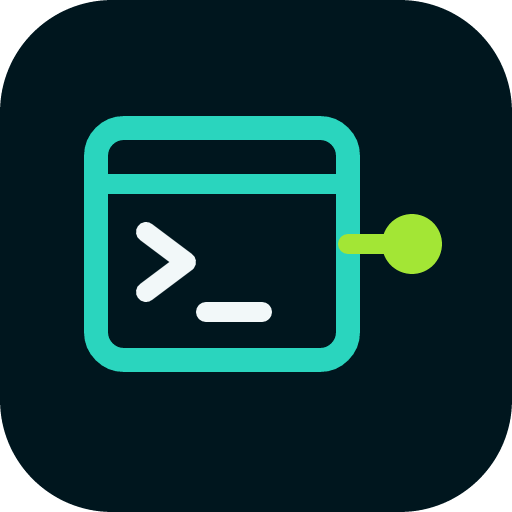

# Termfy Starter Kit

<p align="center">
  <a href="https://promovaweb.com/termfy/">
    <picture>
      <source type="image/svg+xml" srcset="brand/logo/icon.svg">
      
    </picture>
  </a>
</p>

<p align="center">
  <a href="https://promovaweb.com/termfy/">Portal do Termfy</a> ·
  <a href="https://promovaweb.com/docs/termfy/">Documentação</a> ·
  <a href="https://promovaweb.com/harness/">Harness</a> ·
  <a href="https://promovaweb.com/ferramentas/">Ferramentas</a>
</p>

<p align="center">Um projeto da <a href="https://promovaweb.com">Promovaweb</a></p>

Esqueleto de binário em [Bun](https://bun.sh) para construir ferramentas de
terminal com três modos no mesmo executável. É o template do GitHub do
framework [Termfy](https://github.com/promovaweb/termfy), e já vem com as
skills do framework instaladas em `.agents/skills/`.

| Modo | Entrada | Para quem |
| --- | --- | --- |
| TUI | `termfy` sem argumentos, em terminal interativo | pessoas |
| CLI | `termfy <command> [options]`, saída em texto ou `--json` | pessoas, scripts e agentes |
| MCP | `termfy mcp`, servidor Model Context Protocol via stdio | agentes de IA |

Os três modos compartilham identidade, configuração (`~/.termfy/settings.json`),
cofre de credenciais cifrado (`~/.termfy/credentials.json`) e a tabela de
exit codes. A TUI usa o [OpenTUI](https://opentui.com); o CLI publica sua
interface no formato [OpenCLI](https://opencli.org); o MCP usa o
[SDK oficial](https://github.com/modelcontextprotocol/typescript-sdk).

Todo o código é em inglês: arquivos, identificadores, comentários, mensagens,
commands, options, keys e campos do `--json`. A documentação é em português.

```text

   ▌ Termfy  v0.13.0                                                        linux-x64 · Bun 1.4.4

   1 ⌂ Overview    2 ⚙ Settings    3 ◈ Credentials    4 ≡ Docs    5 ℹ About
   ━━━━━━━━━━━━

   ENVIRONMENT                                      STATE
   ╭───────────────────────────────────────────╮    ╭───────────────────────────────────────────╮
   │                                           │    │                                           │
   │  Binary     termfy v0.13.0                │    │  Settings     • defaults                  │
   │  Runtime    Bun 1.4.4                     │    │  Vault        • empty                     │
   │  Platform   linux-x64                     │    │  Master key   not created                 │
   │                                           │    │                                           │
   ╰───────────────────────────────────────────╯    ╰───────────────────────────────────────────╯

   NEXT STEPS
   ╭────────────────────────────────────────────────────────────────────────────────────────────╮
   │                                                                                            │
   │  IN THE TERMINAL                               FOR AGENTS                                  │
   │  → termfy --help                               { "command": "termfy",                      │
   │  → termfy credentials set <name>                 "args": ["mcp"] }                         │
   │  → termfy --skill                                                                          │
   │                                                                                            │
   │  [c] copy MCP config    [r] reload                                                         │
   │                                                                                            │
   ╰────────────────────────────────────────────────────────────────────────────────────────────╯


   0 credentials · defaults  r reload  c copy MCP config  ? help  q quit             ^K commands

```

## Sobre o template

Este repositório é um template do GitHub. Clique em **Use this template**,
abra o clone no agente e peça: "Use termfy-init para fazer o setup deste
projeto". Informe o nome do executável e o propósito da ferramenta. O agente
conduz a configuração e as verificações pela skill.

A pasta [brand/](brand/README.md) é a marca deste template no GitHub. Num
projeto criado a partir dele, troque `brand/` e o cabeçalho deste README pela
sua marca ou remova os dois.

O guia completo está em [docs/customize-template.md](docs/customize-template.md).
Para atualizar ou reparar as skills, use `termfy-init` no modo de
manutenção. O guia do método e o ebook ficam no
[framework](https://github.com/promovaweb/termfy).

## Requisitos

Bun 1.4.4 ou superior. Node.js não é usado.

## Rodar em desenvolvimento

```bash
bun install
bun run dev                 # TUI
bun run dev -- --help       # help do CLI
bun run dev -- about --json
bun run dev -- mcp --list
```

## Commands

| Command | Função |
| --- | --- |
| `termfy` | abre a TUI com as abas Overview, Settings, Credentials, Docs e About |
| `termfy tui [--tab overview\|settings\|credentials\|docs\|about]` | abre a TUI em uma aba |
| `termfy about` | version, executable, runtime, platform e credits |
| `termfy config list\|get\|set\|unset\|path\|schema` | preferências em `settings.json` |
| `termfy credentials set\|get\|list\|remove\|status\|clear` | segredos cifrados em `credentials.json` |
| `termfy mcp [--list]` | servidor MCP via stdio |
| `termfy skill [topic]` | documentação embutida |

Options globais: `--help`, `--version`, `--json`, `--skill [topic]`,
`--opencli`, `--no-color`. Referência completa em [docs/cli.md](docs/cli.md).

## Documentação embutida

```bash
termfy --skill            # tudo, em Markdown
termfy --skill mcp        # uma seção: cli, tui, mcp, config, exit-codes
termfy --opencli          # descrição OpenCLI em JSON
```

A pasta [docs/](docs/README.md) entra no binário em tempo de build. Um agente
lê a documentação sem acesso ao repositório.

## Exit codes

| Code | Name |
| --- | --- |
| 0 | `SUCCESS` |
| 1 | `GENERIC_ERROR` |
| 2 | `USAGE` |
| 3 | `CONFIG` |
| 4 | `CREDENTIALS` |
| 5 | `NETWORK_OR_API` |
| 6 | `NOT_FOUND` |
| 7 | `PERMISSION` |
| 8 | `NO_TTY` |
| 9 | `MCP` |
| 130 | `INTERRUPTED` |

Detalhes em [docs/exit-codes.md](docs/exit-codes.md).

## Configuração e credenciais

```bash
termfy config set tui.theme day
termfy credentials set openai.api_key        # digita sem eco
printf '%s' "$TOKEN" | termfy credentials set github.token --stdin
termfy credentials status
```

Os arquivos ficam em `~/.termfy/` com permissão 0600. As credenciais são
cifradas com AES-256-GCM; a master key vem de `TERMFY_MASTER_KEY` ou de
`~/.termfy/master.key`. Veja [docs/configuration.md](docs/configuration.md).

## MCP

```json
{ "mcpServers": { "termfy": { "command": "termfy", "args": ["mcp"] } } }
```

Tools: `about`, `exit_codes`, `skill`, `config_list`, `config_get`,
`credentials_status`. Resources: `termfy://about`, `termfy://exit-codes`,
`termfy://skill`, `termfy://skill/{topic}`. Prompt: `operate`.
Detalhes em [docs/mcp.md](docs/mcp.md).

## Estrutura

```text
src/        código do binário (app, cli, config, mcp, tui, skill)
docs/       documentação embutida e opencli.json
template/   stubs de command, screen e tool
.agents/    skills do framework instaladas via npx skills (skills-lock.json)
scripts/    build, init e checks
tests/      bun test
brand/      marca do template no GitHub (troque ou remova no projeto derivado)
```

Arquitetura em [docs/architecture.md](docs/architecture.md).

## Validar, compilar e publicar

```bash
bun run validate      # typecheck, testes, skills:check, opencli:check, docs:check, build
bun run build         # dist/termfy
bun run build:all     # linux-x64, linux-arm64, darwin-x64, darwin-arm64, windows-x64
```

Releases seguem [docs/release.md](docs/release.md): versão em
`package.json`, entrada no `CHANGELOG.md`, tag `vX.Y.Z` e GitHub Release com
binários gerados pelo workflow. O guia do método em PDF e EPUB fica no
framework, não aqui.

## Licença

Distribuído sob a [licença MIT](LICENSE), porque o starter kit é a base do
binário de quem usa: a ferramenta que você cria a partir dele é sua e pode ter
a licença que você escolher. O framework [Termfy](https://github.com/promovaweb/termfy),
com as skills e o método, segue sob a GNU AGPL 3.0. A licença não concede o uso
do nome e do logo do Termfy nem da marca Promovaweb.
